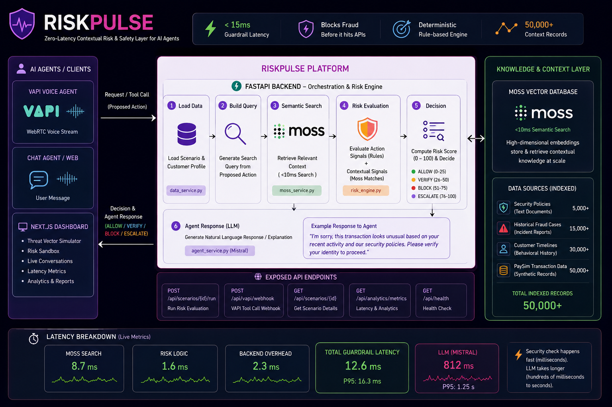
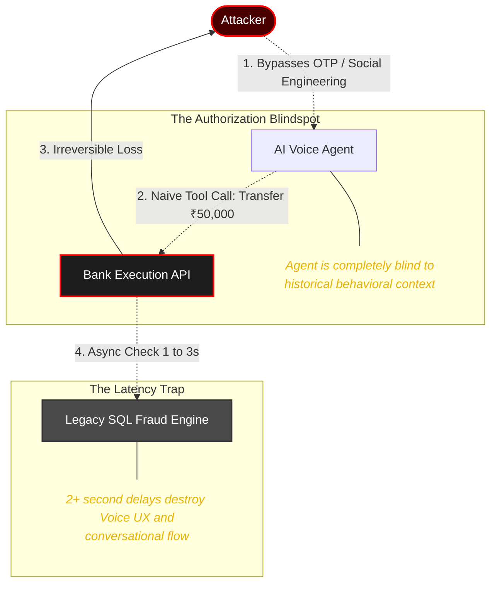
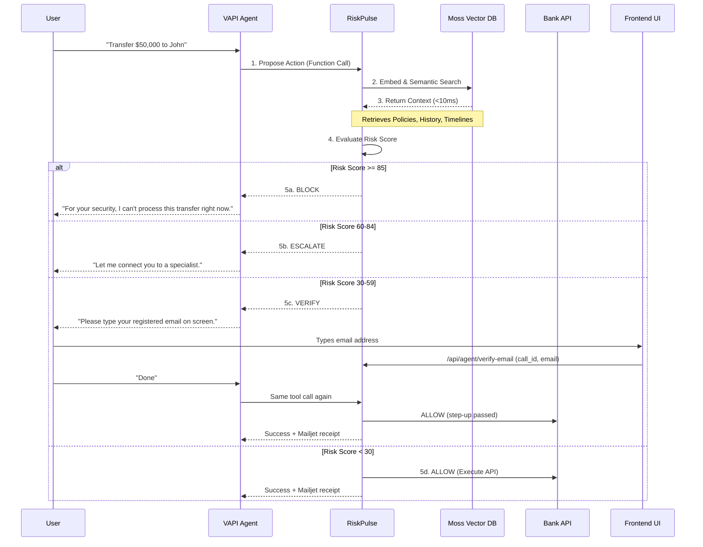
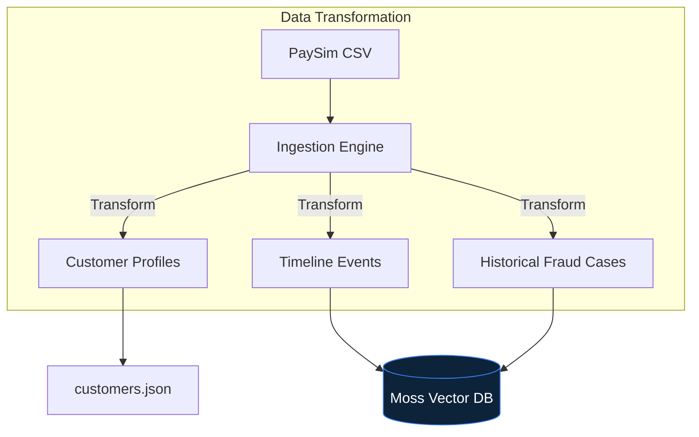
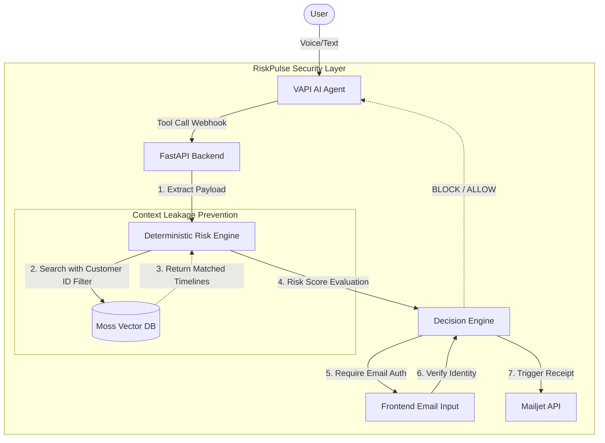

# ⚡ RiskPulse

**Zero-Latency Contextual Risk & Safety Layer for AI Agents**



## 📖 Overview

**RiskPulse** is an enterprise-grade contextual security guardrail built specifically for AI agents operating in the banking and fintech sectors. It acts as an unbreakable interception layer between an AI Voice/Chat Agent and a bank's execution APIs, ensuring that no high-risk action (like transferring money or resetting credentials) is executed without strict, context-aware semantic evaluation.

## 🌟 Key Features Implemented

1. **Interactive Threat Vector Simulator:** A beautiful, real-time Next.js dashboard that allows you to inject nominal, anomalous, and account takeover (ATO) telemetry directly into the Risk Engine and watch the live semantic retrieval process.
2. **VAPI Voice Agent Integration:** A VAPI assistant whose 12 tools (`verify_identity`, `get_account_summary`, `transfer_money`, `close_account`, etc.) all call the RiskPulse webhook (`/api/vapi/webhook`) before anything executes. Callers must verify a real Customer ID first; unknown IDs are rejected and the call locks after 3 failed attempts.
3. **Zero-Latency Moss Semantic Retrieval:** The Moss index is loaded in-process once at startup, so each semantic lookup of fraud cases and policies takes ~1ms. The query embedding (Mistral API) is measured and shown separately, since it is a network call.
4. **Context Leakage Prevention:** Built-in metadata filtering during semantic search to ensure that one user's fraud history does not inadvertently penalize another user's baseline risk score during evaluation.
5. **Deterministic Hybrid Risk Engine:** Combines static rule thresholds (e.g., 3x average amount) with unstructured semantic insights (e.g., matching a historical fraud case) to output a 0-100 risk score.
6. **Email Step-Up Verification:** When an action scores `VERIFY`, the agent asks the caller to type their registered email on screen. A match (max 3 attempts) lets that one action through, so a leaked Customer ID alone is not enough.
7. **Automated Mailjet Email Triggers:** Sends a confirmation email via Mailjet after every `ALLOW`ed action.

## 🛑 The Problem Statement

The rapid adoption of AI Voice Agents (like VAPI, OpenAI Realtime) in fintech has created a critical security paradox: **Agents are smart enough to execute transactions, but completely blind to behavioral context.**

When an AI agent is connected directly to a bank's execution APIs, three massive vulnerabilities emerge:

1. **The Authorization Blindspot (The "Naive AI" Problem):**
   LLMs are designed to be helpful. If an attacker successfully bypasses basic authentication (e.g., SIM swapping for an OTP) and calmly asks the voice agent to transfer ₹50,000 to a new account, the LLM will naively execute the tool call. The AI has absolutely no awareness that this customer has never transferred more than ₹2,000 in their life.
2. **The Latency Trap (The Voice AI Killer):**
   Traditional banking fraud engines (which query massive SQL data lakes) take anywhere from 500ms to 3 seconds to evaluate a transaction. In a conversational voice interface, introducing a 2-second delay before every action completely destroys the illusion of human conversation, leading to dead air, overlapping speech, and a terrible user experience.

3. **The Brittle Rules Engine:**
   Hardcoded `if/else` rules (e.g., `if amount > 10000: block`) are too rigid. They cannot understand the nuance of unstructured security policies, nor can they dynamically adapt to a specific user's historical fraud cases or changing baselines.



**The TL;DR:** We need a way to inject deep, historical fraud context and policies directly into the AI's decision loop, and it **must happen in under 20 milliseconds** to maintain voice fluidity.

## 💡 The Solution

RiskPulse solves this by placing a **deterministic, zero-latency guardrail** between the AI agent and the bank's APIs.



### 🔍 Anatomy of a `BLOCK` Decision: Why Was the \$50,000 Transfer Blocked?

In the sequence above, why did RiskPulse immediately block the **\$50,000 transfer to John** instead of blindly executing it? 

Traditional rule engines either allow it (if the account's daily limit is \$50,000) or take 2+ seconds querying legacy databases. RiskPulse evaluated **Behavioral Baselines, Semantic History, and Institutional Policies in < 10ms**:

| Evaluation Layer | Retrieved Signal & Context | Risk Impact |
| :--- | :--- | :--- |
| **1. Customer Baseline** | Customer profile indicates historical average transfer is **\$1,313** (lifetime max: \$2,000). Baseline risk score: `20`. | Baseline: **20** |
| **2. Behavioral Velocity Anomaly** | The requested **\$50,000** transfer is **>38x higher than the customer's average**. Static rule engine flags an extreme velocity spike (>3x average). | **+30 pts** |
| **3. Recipient Context** | "John" is flagged as a **`NEW` beneficiary** who has never received funds from this account before. | **+20 pts** |
| **4. Moss Timeline Retrieval** | Moss retrieves recent chronological events from vector storage in < 8ms: **`NEW_DEVICE_LOGIN`** (unrecognized device) followed by **`PASSWORD_RESET`** and **`FAILED_OTP`** within the last 24 hours. | **+25 pts** |
| **5. Historical Case Pattern Match** | Moss semantically matches the event pattern against the bank's universal fraud database (**`CASE_FRAUD_042: Account Takeover via Device Change`** — a bank-wide institutional precedent, not the user's personal record). | **+20 pts** |
| **6. Security Policy Enforcement** | Moss retrieves and matches institutional security policies:<br>• **`POL_001` (Account Takeover High Risk):** *"When a password reset and login from an untrusted device occur shortly before a high-value financial action, automatic execution must be blocked."*<br>• **`POL_002` (New Beneficiary Limit):** *"Transfers to a new beneficiary exceeding standard average amounts must be flagged/blocked if accompanied by unusual device activity."* | **+15 pts** |

#### 🧮 The Scoring Breakdown

```text
Final Risk Score = min(20 [Baseline] + 30 [Velocity] + 20 [New Payee] + 25 [Timeline] + 20 [Fraud Match] + 15 [Policy], 100)
                 = 100 / 100
```

- **Thresholds:** `BLOCK` $\ge 85$, `ESCALATE` 60–84, `VERIFY` 30–59, `ALLOW` < 30
- **Decision Engine Output:** `decision: "BLOCK"`, `confidence: 0.99`
- **Result:** The Bank Execution API is never invoked. The AI Agent seamlessly informs the caller without dead air: *"For your security, I cannot process this transfer right now. Please visit your nearest branch with a valid photo ID."*

---

## 📊 Dataset & Synthetic Context Architecture

To power the Moss context retrieval engine, we mapped raw transaction data into rich, semantic behavioral logs.

### The PaySim Synthetic Dataset

We utilized the **PaySim Mobile Money Fraud dataset**, which provides hyper-realistic synthetic financial logs. Due to the massive file size (470MB), we do not track the raw CSV in this repository.

> **Dataset Download:** You can download the dataset directly from Kaggle: [PaySim Dataset](https://www.kaggle.com/datasets/moonknightmarvel/paysim). Place it in `backend/data/raw/paysim.csv`.

Rather than dumping raw CSVs into Moss, we transformed these transaction lines into **Synthetic Behavioral Profiles**.



### 💸 Hackathon Limitations: Why Only 1,173 Records?

While the PaySim dataset contains millions of rows, we deliberately restricted our Moss indexing script to **1,173 high-density context records**.

1. **\$5 API Credit Limit:** We strictly optimized our indexing calls to ensure we didn't exhaust our initial \$5 Moss hackathon credit grant during development!
2. **High-Density over High-Volume:** Instead of blindly storing millions of safe \$10 transfers, we prioritized indexing specific edge cases, overarching security policies, and known account-takeover (ATO) markers. This ensures that the engine retrieves the most impactful signals in sub-10ms without wasting tokens.

---

## 🏛️ System Architecture

RiskPulse follows a modern, decoupled architecture designed for speed and scalability.



- **Frontend (Next.js 16, static export):** A real-time, cyberpunk-themed security dashboard built with React, TailwindCSS, and Framer Motion. It visualizes the intercepted telemetry stream, Moss retrieval latency, and the final risk decision in real-time.
- **Backend (FastAPI):** A high-performance async Python backend that exposes endpoints for the frontend sandbox and VAPI webhooks.
- **Vector Database (Moss):** The core intelligence engine mapping timelines and policies. Moss is a real-time semantic search runtime built in Rust and WebAssembly, allowing for sub-10ms lookups with zero infrastructure, making real-time Voice AI guardrails feasible.
- **Voice Agent (VAPI):** The conversational layer that interacts with the user over WebRTC.

---

## 🛠️ Tech Stack

- **Frontend:** Next.js, React, TailwindCSS, Framer Motion, Lucide Icons, VAPI Web SDK
- **Backend:** Python, FastAPI, Uvicorn, Pydantic
- **AI/Vector:** Moss Vector DB, Mistral AI (Optional fallback LLM)
- **Voice & Email:** VAPI, Mailjet
- **Data:** Synthetic PaySim Dataset

---

## 🚀 Setup Instructions

### Prerequisites

- Python 3.10+ and Node.js 18+
- Moss project ID & key, Mistral API key
- VAPI private API key, public key and assistant ID
- Mailjet API key, secret and a verified sender email
- A public URL for the backend (Render deploy, or ngrok for local)

### 1. Environment

Copy the variables from `.env.example` into `backend/.env` and `frontend/.env`.

### 2. Data

```bash
cd backend
python scripts/generate_synthetic_data.py   # optional: regenerates customers/events/policies/cases
python scripts/ingest_new_customers.py      # adds the demo customers that have registered emails
python scripts/ingest_moss.py               # (re)builds the Moss index: policies, cases, timelines, 1,000 PaySim rows
```

Re-running `ingest_moss.py` deletes and rebuilds the index, which uses Mistral embedding calls and Moss credits.

### 3. Configure the VAPI assistant

```bash
cd backend
python setup_vapi.py --check   # show current tools and server URL
python setup_vapi.py           # back up config, then apply prompt + 12 tools + VAPI_SERVER_URL
```

### 4. Run

```bash
./start.sh          # macOS/Linux
start.bat           # Windows
```

Dashboard: `http://localhost:3000` · API docs: `http://localhost:8000/docs`. For local voice calls, expose port 8000 (e.g. `ngrok http 8000`), set `VAPI_SERVER_URL=https://<ngrok-host>/api/vapi/webhook` and re-run `setup_vapi.py`.

### 5. Try it

- **Threat Vector Simulator:** the three presets give ALLOW, VERIFY and BLOCK.
- **Voice Agent:** press call, then say a Customer ID:
  - `C9876543210`: verifies; a transfer asks for the email step-up (registered email in `customers.json`).
  - `CUST_DEMO_ATO`: blocked at verification (account takeover timeline).
  - Any made-up ID: rejected; the call locks after 3 tries.

### Tests

```bash
cd backend && python -m tests.test_guardrail
```
