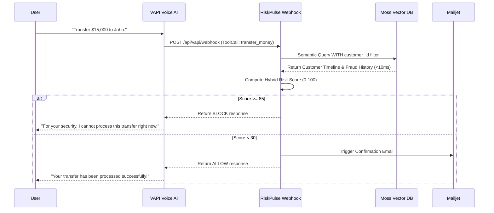
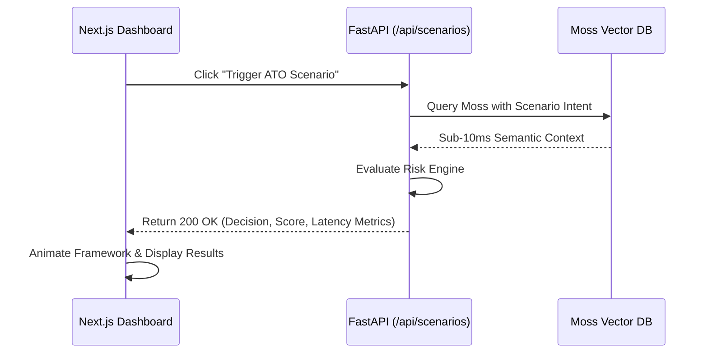

# Architecture Deep Dive - RiskPulse

RiskPulse follows a modern, decoupled architecture designed for extreme speed (sub-10ms evaluations) and high scalability, leveraging Moss as a zero-latency semantic retrieval engine.

---

## 🏗️ 1. Component Responsibilities

### Frontend (Next.js 14)
- **Role:** Security Operations Dashboard & Threat Vector Simulator.
- **Responsibilities:**
  - **Threat Simulator:** Allows security teams to inject synthetic telemetry (Nominal, Anomalous, ATO) directly into the Risk Engine via the `/api/scenarios/{id}/run` endpoint.
  - **Voice UI:** Integrates the VAPI Web SDK for real-time microphone interactions, shows the call's RiskPulse evaluations, and hosts the email step-up box.
  - **Visualizations:** Renders live latency metrics (Moss vs. Risk Logic) and the final Risk Score (0-100) using Framer Motion animations.

### Backend (FastAPI)
- **Role:** Orchestrator, Webhook Receiver, and Hybrid Risk Engine.
- **Responsibilities:**
  - **VAPI Webhooks:** Exposes `/api/vapi/webhook` to catch high-risk tool calls (`transfer_money`, etc.) before they reach execution.
  - **Semantic Retrieval (`moss_service.py`):** Queries Moss using the requested action and strictly enforces Context Leakage Prevention via `customer_id` filters.
  - **Hybrid Risk Engine (`risk_engine.py`):** Computes a deterministic Risk Score combining static thresholds (e.g., amount > 10,000) and semantic insights (e.g., historical ATO cases).
  - **Call Sessions (`vapi_service.py`):** Tracks per-call identity (`call.id`), failed attempts and the one-shot email step-up.
  - **Email Triggers (`email_service.py`):** Sends confirmation receipts via Mailjet when an action is `ALLOW`ed.

### Vector Database (Moss)
- **Role:** Contextual Knowledge Retrieval (Zero-Latency Guardrail).
- **Responsibilities:**
  - Built in Rust/WASM, acting as a sub-10ms local or edge semantic search runtime.
  - Stores 1,173 synthetic high-density behavioral profiles (Timelines, Policies, Fraud Cases).

### Third-Party Services
- **VAPI:** Conversational Voice AI layer. Handles WebRTC, speech-to-text, LLM routing, and structured tool calling.
- **Mailjet:** Transactional email API for confirming successful actions to the customer.

---

## 🧠 2. Core Mechanisms

### Context Leakage Prevention (Metadata Filtering)
Vector databases inherently perform *global* semantic searches. Without filtering, a query like "Is this transfer safe?" might retrieve a fraud case from *another* customer, unfairly penalizing the current user.
**The Fix:** The verified `customer_id` comes from the call session (never from the caller's tool arguments). Semantic results are over-fetched and any `customer_timeline` document whose `customer_id` metadata does not exactly equal the caller's is dropped; the caller's own timeline is fetched by ID (`TIMELINE_<customer_id>`) from an in-process cache, so it is always present.

### The Hybrid Risk Engine (0-100 Score)
We do not rely solely on an LLM or solely on hardcoded rules. We use a hybrid, deterministic scoring system:
1. **Base Score:** The customer's baseline risk.
2. **Rule-Based Penalties:** e.g. amount > 3x average `+30`, new beneficiary `+20`, per-action penalties (account changes, PIN reset, closure…).
3. **Timeline Penalties:** new device login `+20`, password reset `+25`, failed OTP `+20`, suspicious location change `+15`.
4. **Semantic Penalties:** matching account-takeover case `+20` and violated blocking policy `+15` (only when the score is already elevated). Each signal counts once.
5. **Fail-safe:** if retrieval fails, `+30` so the action cannot pass silently.
6. **Decision:**
   - `>= 85`: **BLOCK**
   - `60-84`: **ESCALATE** (human agent)
   - `30-59`: **VERIFY** (email step-up)
   - `< 30`: **ALLOW**

---

## 🔄 3. Data Flows

### Flow A: VAPI Voice Agent Execution (Live Webhook)
This is the primary flow when a user talks to the AI Agent over the phone.

### Flow B: Threat Vector Simulator (Dashboard Sandbox)
This flow powers the Next.js UI allowing developers to visually test specific fraud scenarios.

---

## ⏱️ 4. Latency Measurement Methodology

We use Python's `time.perf_counter()` to measure the precise execution time of the guardrail:
- **Embedding Latency:** The Mistral API call that embeds the query (a network round-trip, typically 300-600ms).
- **Moss Search Latency:** Time for `client.query()` against the locally loaded index plus the cached timeline lookup (~1ms).
- **Risk Logic Latency:** The deterministic Python evaluation.
- **Total Guardrail Latency:** Wall-clock time for all of the above.

The Moss and risk-engine portion stays well under 10ms; the embedding call dominates and is reported separately rather than hidden.
